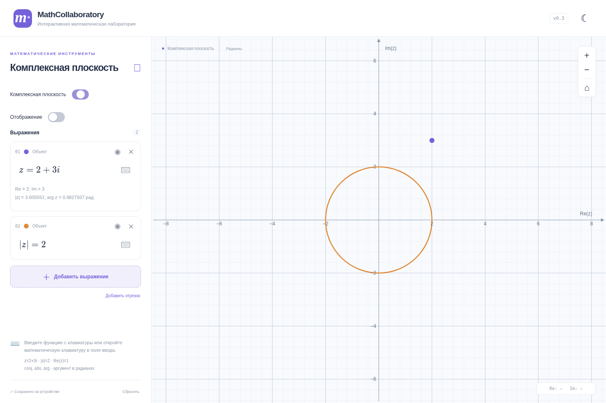
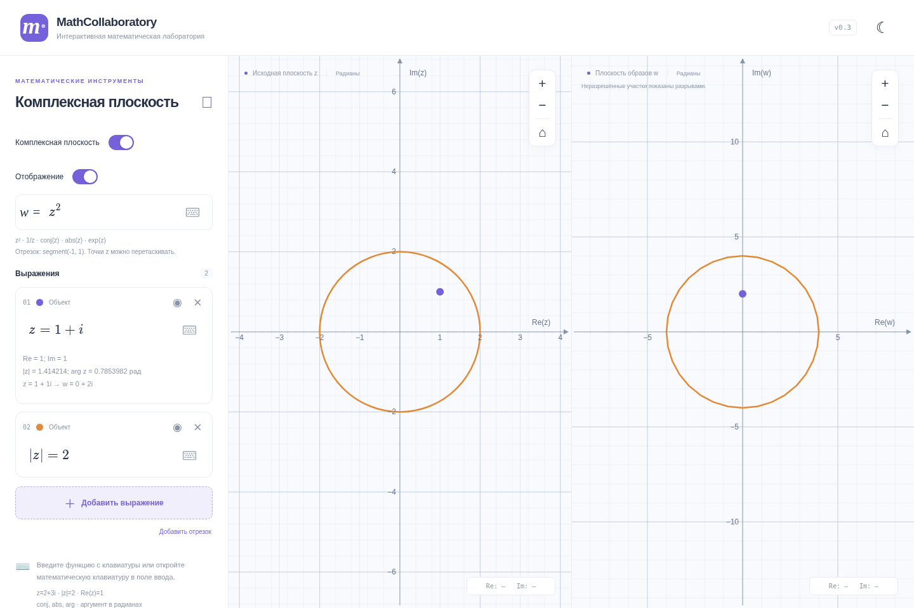
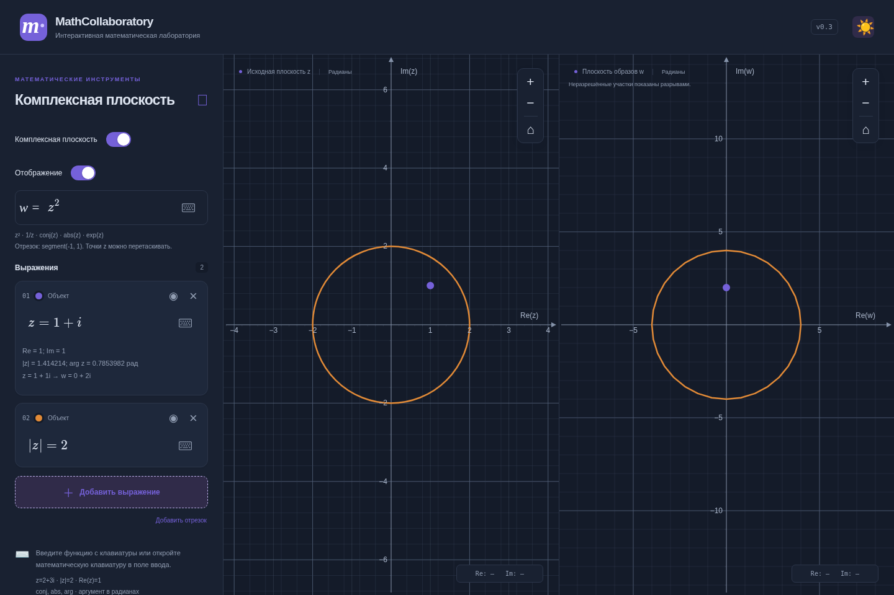
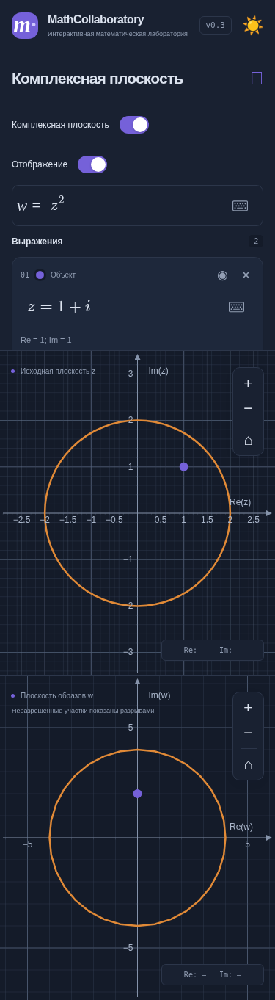

# Комплексные отображения v0.3

Ветка `feature/complex-mappings-v0.3` начата от main с уже объединённой v0.2.1 (`dc7ad7d`). Её навигация, окружности и исправления сохранены. Новых зависимостей и анимационных библиотек нет.

## Использование

В комплексном режиме доступен switch «Отображение». В выключенном состоянии исходная плоскость занимает всю область. При включении появляются поле MathLive `w = …` и независимая плоскость образов. На широком экране окна равны по ширине; при ширине до 1100 px располагаются вертикально. На мобильном экране каждая плоскость имеет не менее 360 px в итоговой компоновке; боковая панель прокручивается отдельно.

Поддержаны `z`, `z^2`, `z^3`, `1/z`, `z+1+i`, `(z-1)/(z+1)`, `conj(z)`, `abs(z)`, `exp(z)`, `sin(z)`, `cos(z)`, их арифметические композиции, целочисленные степени и LaTeX-дроби. Можно вставлять формулу с префиксом `w=`. Прежние ограниченные функции `arg`, `Re`, `Im` доступны и в отображениях. Переменная — только z; постоянные — числа и i. Произвольных имён, присваиваний, доступов к свойствам, массивов или выполнения кода нет.

- Точка: `z=1+i`.
- Окружность: `|z|=1`, `|z-1-i|=2`.
- Отрезок: `segment(-1,1)` или `segment(-1-i,2+i)`. Есть кнопка «Добавить отрезок».
- Существующие Re/Im-прямые сохраняются на исходной плоскости; их образы пока не строятся, о чём сообщает примечание на w-плоскости.

У точек показаны численные z и w. Цвет и видимость исходного объекта применяются к образу. При включённом отображении точки исходной плоскости можно перетаскивать: сохраняется тот же маркер JSXGraph, а формула преобразуется в `z=a+bi` с округлением координат до девяти знаков после запятой. Образ обновляется сразу. Изменение через редактор работает в обе стороны.

## Архитектура

| Слой | Реализация |
| --- | --- |
| Разбор и безопасные операции | `src/complex/math.ts`: mathjs AST и собственный allowlist-обход, строящий ограниченные функции-замыкания. Произвольные mathjs evaluate/compile не используются. Общий вычислитель обслуживает константы и отображения; z и exp/sin/cos разрешаются только в контексте отображения. |
| Формула отображения | `src/mapping/expression.ts`: разбор, оценка сложности, обработка неопределённостей без падения UI. |
| Параметризация | `src/mapping/parameterize.ts`: окружность `c+r exp(2πit)`, отрезок `(1-t)a+tb`, t от 0 до 1. |
| Численный образ | `src/mapping/sample.ts`: адаптивная дискретизация `f(z(t))` в экранной метрике. |
| Кэш сцен | `src/mapping/useImagePlots.ts`: независимые от JSXGraph вычисления и один кэш выборки на кривую/область просмотра. Неизменённые кривые не вычисляются заново при перетаскивании отдельной точки. |
| Отрисовка | `src/complex/render.ts`: сохранение маркеров по id, исходные окружности/отрезки, параметрические образы. |
| Окна и интерфейс | `ComplexWorkspace`, `MappingControls`, `PointDetails`; Graph остаётся общей доской, App связывает состояние и компоненты. |

Целые степени вычисляются двоичным возведением в степень через операции mathjs, чтобы `(1+i)^2` давало ровно 2i без артефакта полярной формулы. Отрицательные степени начинают с обратного числа; есть проверки нуля, переполнения и диапазона показателя.

## Дискретизация и ограничения

На каждой кривой исходно 32 интервала. Проверяются середина и дополнительная внутренняя проба с нерациональным относительным смещением, чтобы уменьшить риск периодического совпадения проб. Сравниваются отклонение от хорды (порог около 0.7 px) и экранный скачок между концами (до 100 px). Неудовлетворительные интервалы подразделяются, максимум на 12 уровней.

Неопределённые значения, нерешённые скачки, исчерпание глубины/бюджета и отдалённые части образа создают NaN-разрывы. Непроверенная хорда не рисуется. Интервалы с пробами на одной дальней стороне окна могут пропускаться как невидимые. Это численная аппроксимация, не автоматический поиск всех особенностей функции: узкие детали между пробами или очень высокие частоты могут быть пропущены.

Одна кривая получает не более 2048 вызовов f на обновление. Общий бюджет распределяется между видимыми кривыми и уменьшается с ростом стоимости AST (базово до 12000 вызовов суммарно). При большом числе сложных кривых результат может быть неполным; исходные данные не удаляются. Кэши хранят только одну текущую выборку для каждой кривой. Гарантировать FPS на произвольном устройстве эти ограничения не могут, но число вычислений всегда конечно.

Формулы ограничены 500 символами и 80 узлами построенного вычислителя; исходные геометрические константы сохраняют прежний лимит 150 узлов. Целые степени — от -1000 до 1000; 0^0, деление на ноль, arg(0) и переполнение обрабатываются без падения. До 50 объектов на режим.

Математический результат отделён от отрисовки: конечное w вне диапазона ±1e9 показывается в числовом выводе с пометкой, но не передаётся SVG. Неопределённое/непредставимое значение даёт сообщение, а не фиктивную точку. Математическое значение abs на окружности может выродить образ в одну точку; для такого пути используется круглый конец штриха. Есть обычная погрешность floating point.

Образы областей, domain coloring, обратные отображения и поиск особенностей не реализованы. У отрезков задаются постоянные комплексные концы, без ссылок на другие именованные точки. Автоматического подбора области просмотра под все образы нет: доступны независимые pan, zoom и сброс.

## Анимация, масштаб и доступность

CSS Grid/opacity анимации длятся 300 мс. Доска z не пересоздаётся при включении отображения. Доска w создаётся при первом открытии, после чего скрывается через visibility/inert и переиспользуется при повторных переключениях. Быстрое переключение разворачивает CSS-переход, а не создаёт очередь таймеров или новых досок. При выключении очистка образов прекращает их вычисления. При переходе в вещественный режим комплексные доски освобождаются.

Единственный ResizeObserver приложения сохраняет центр и число пикселей на математическую единицу. Конкурирующий штатный resize JSXGraph отключён. Resize и восстановление границ объединены через suspendUpdate/unsuspendUpdate в одну полную перерисовку. Одинаковый масштаб Re/Im сохраняется отдельно в каждой доске. Масштабы разных досок могут различаться.

Переключатели используют role=switch, aria-checked и нативное управление Space/Enter. Скрытая плоскость и поле имеют aria-hidden/inert. Prefers-reduced-motion отключает переходы. На узком экране подсказки сокращены, поля MathLive ограничены шириной панели, окна имеют разумную минимальную высоту; горизонтального переполнения нет.

## Состояние и миграция

Ключ `mathcollaboratory.v1` и version=1 сохранены. Поле `mapping` добавлено совместимо: enabled, latex, viewport. Старые сохранения получают выключенное отображение и z² по умолчанию. Исходные комплексные объекты и их viewport, вещественные формулы и параметры не переносятся и не удаляются. Повреждение новых настроек изолировано от здоровых объектов. Некорректный текст формулы сохраняется для исправления.

Сброс вещественного режима не затрагивает комплексный; сброс комплексного возвращает его исходные объекты и настройки отображения. Обычное выключение отображения ничего не сбрасывает.

## Проверки

- 233 unit tests (включая все прежние 190).
- 29 браузерных сценариев Chromium (25 прежних и 4 новых).
- TypeScript, production build и git diff --check.
- В CI WebKit проверяет прежние четыре сценария навигации и четыре новых сценария отображений; статус указан в PR. Локальный WebKit ограничен отсутствующими системными библиотеками, как отмечено в отчёте v0.2.1.

Обязательные примеры проверяются численно: (1+i)²=2i, 1/2=0.5, полюс 1/z при z=0, сопряжение 1+i, двойной обход единичной окружности. Дополнительно проверены exp/sin/cos, сдвинутый полюс на отрезке, полюс на окружности, бюджет выборки, миграция, сохранение ошибок, независимый масштаб и численные диапазоны.

Браузерные проверки охватывают открытие/закрытие и быстрые переключения, сохранение id досок/центра/масштаба, drag с записью формулы, reload, цвет, обе темы, вертикальную мобильную компоновку, отсутствие горизонтального переполнения и reduced motion. Скриншоты подготовлены для одной и двух плоскостей.

Существующие предупреждения Vite о размере JS и eval внутри JSXGraph остаются. Физические MacBook/iPad и реальные Safari/iOS не проверялись; Linux WebKit не заменяет проверку физических жестов.

## Снимки

