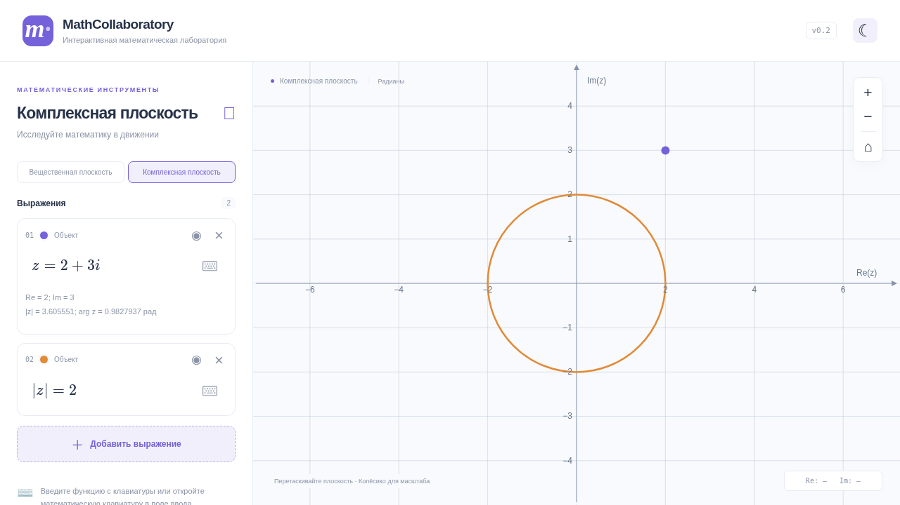
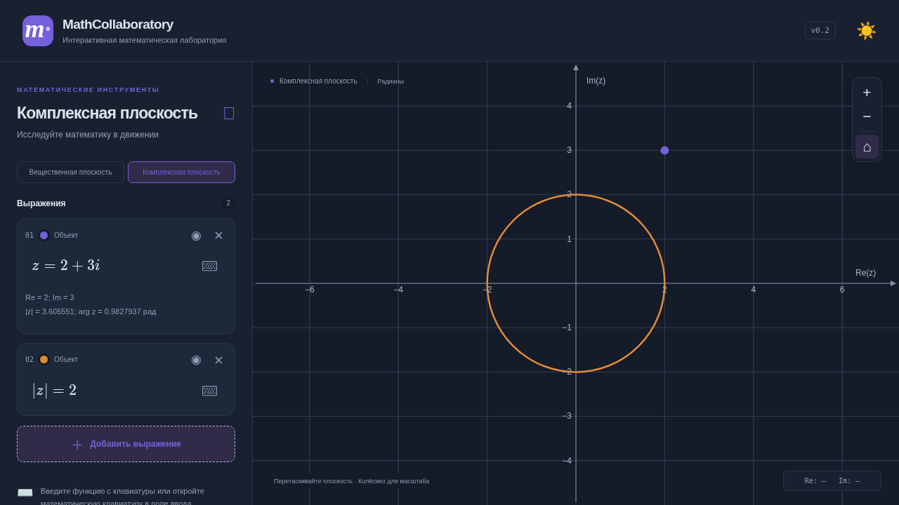
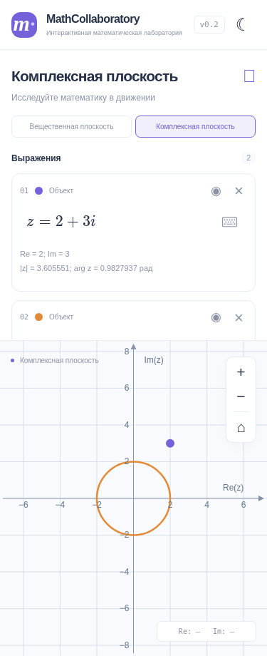

# Комплексная плоскость v0.2

Два режима используют общий визуальный стиль, карточки выражений, MathLive и координатную доску JSXGraph. Вещественный парсер и его вычисления не заменены. Переключатель сохраняет независимые списки и области просмотра; тема общая. Сброс затрагивает построения, параметры (в вещественном режиме) и область просмотра только текущего режима.

## Синтаксис

| Пример | Результат |
| --- | --- |
| `z = 2+3i`, `z = -1-i`, `z = 3`, `z = 2i` | Точка, координаты, модуль, главный аргумент в радианах |
| `(1+i)(1-i)` | Точка 2 на вещественной оси |
| `z = (1+i)/(1-i)` | Точка i |
| `z = i^2`, `z = i^{-1}` | Целочисленные степени |
| `conj(2+3i)` или `\overline{2+3i}` | Сопряжение |
| `abs(3+4i)` или `|3+4i|` | Модуль, точка 5 |
| `arg(i)`, `Re(1+2i)`, `Im(1+2i)` | Вещественные значения как точки |
| `|z|=2` | Окружность с центром 0 |
| `|z-(1+i)|=2` | Окружность с центром 1+i |
| `Re(z)=1`, `Im(z)=-2` | Вертикальная и горизонтальная прямые |

Поддержаны вложенные LaTeX-дроби, стандартные скобки MathLive, `operatorname` для комплексных функций. Экранная клавиатура комплексного режима содержит z, i, conj, abs, arg, Re и Im. Для смещённого комплексного центра обязательны внешние скобки: неоднозначная запись `|z-1+i|=2` отклоняется.

## Разделение ответственности

- `src/complex/math.ts`: преобразование ограниченного LaTeX в вход mathjs, обход только разрешённых AST-узлов, комплексные операции mathjs. Произвольные `evaluate`/`compile`, присваивания, доступ к свойствам, массивы и неизвестные функции запрещены.
- `src/complex/geometry.ts`: независимый от React и JSXGraph union точек, окружностей и прямых. Здесь же минимальный интерфейс `ComplexMapping` для будущих отображений; сами отображения не реализованы. Области и параметрические кривые можно добавить отдельными вариантами union, не смешивая их с вычислителем.
- `src/complex/render.ts`: создание объектов JSXGraph из геометрии.
- `src/components/Graph.tsx`: общая доска, оси, сетка, навигация, курсор и ResizeObserver. Единицы по осям равны; при прямоугольном окне числовые пределы различаются. Область просмотра сохраняется при pan/zoom и восстановлении режима.
- `src/App.tsx`: переключение режима, общие карточки объектов, ошибки, настройки и сброс текущего режима.
- `src/state/store.ts`, `src/state/view.ts`: проверка независимых списков, параметров и диапазонов. Ключ `mathcollaboratory.v1` и version=1 сохранены, новые поля добавлены совместимо: mode, realViewport, complex.expressions и complex.viewport. Старое сохранение без этих полей получает безопасные значения по умолчанию. Повреждение одного списка не удаляет данные другого.

Новых зависимостей нет. Вещественный модуль `src/math/expression.ts` не изменён.

## Проверки

- `pnpm typecheck` — успешно.
- `pnpm test` — 158 тестов, из них 106 прежних и 52 комплексной арифметики/геометрии/состояния.
- `CHROMIUM_PATH=/usr/bin/chromium pnpm test:browser` — 17 тестов, из них 12 прежних и 5 комплексного режима.
- `pnpm build` — успешно; прежние предупреждения JSXGraph об eval и Vite о размере JS остаются.
- Проверены i²=-1, (1+i)(1-i)=2, |3+4i|=5, деление на ноль, отрицательные степени, аргумент нуля, отклонение недопустимого AST и неоднозначной геометрии, миграция v0.1.1, повреждённые списки и области просмотра.
- В браузере проверены независимые списки и масштабы, восстановление ошибки без потери формулы, равные единицы после zoom/resize на desktop/mobile, pan, курсор, тема, текущий сброс обоих режимов, видимость/цвет/удаление, настоящий клавиатурный ввод и перезагрузка.

## Ограничения

- Точки редактируются формулой; перетаскивание точек пока не реализовано. Перемещение самой плоскости работает.
- Поддерживаются только постоянные комплексные выражения и перечисленные геометрические уравнения. Параметры в комплексном режиме, области, параметрические кривые, отображения w=f(z), второе окно и domain coloring не реализованы.
- Степени целые от -1000 до 1000; деление на ноль, 0^0, arg(0), бесконечные результаты дают понятную ошибку. Для точки 0 модуль равен 0, аргумент показывается как неопределённый.
- Ограничения ввода: 500 символов для нового ввода, 150 узлов AST, 50 объектов на режим. Старый длинный ввод остаётся доступным для исправления.
- Действует стандартная погрешность арифметики floating point. Аргумент главный, в диапазоне [-π, π].
- Проверен Chromium; реальные Safari/iOS/Android пока не проверялись.

## Снимки

