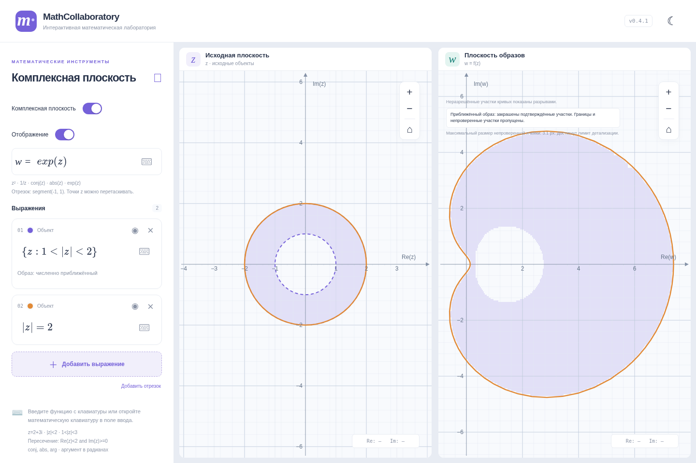
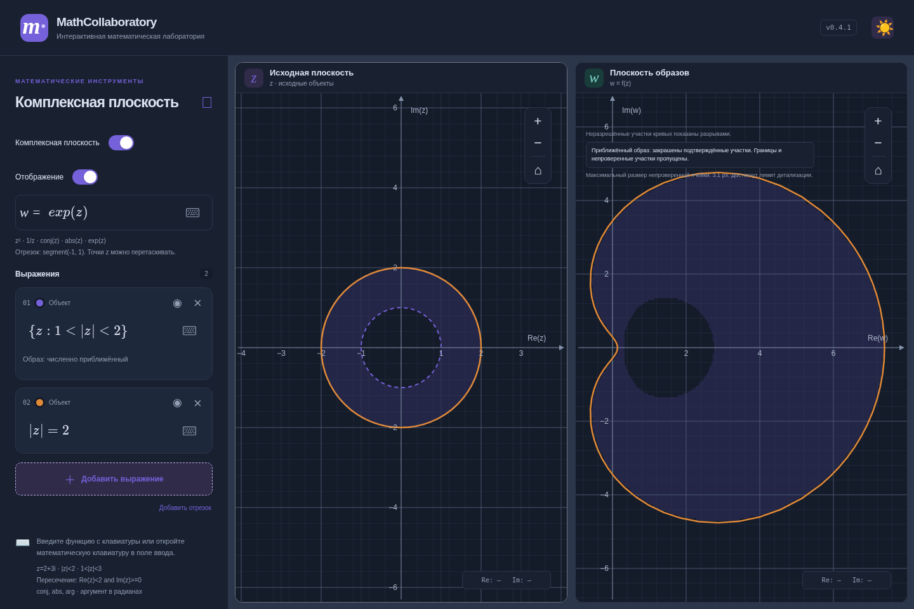
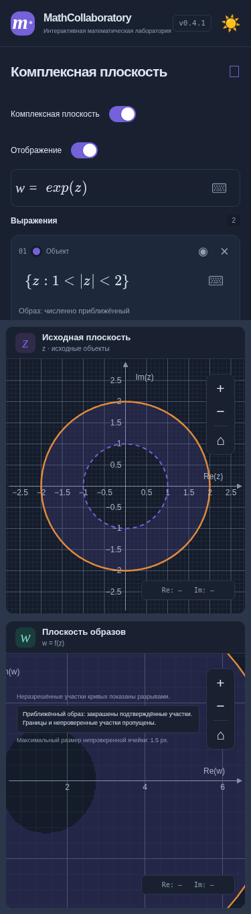

# v0.4.1 — ввод и расширение образов областей

Основа — main `b626d21`, содержащий объединённую v0.4 (PR #5). Ветка: `fix/complex-regions-v0.4.1`. Новых зависимостей нет; формат localStorage не изменён.

## Фактический ввод MathLive

Физический ввод `Re(z)<2` в MathLive 0.111.4 возвращает `\operatorname{\mathrm{Re}}\left(z\right)<2`. Виртуальная клавиша Re возвращает `\operatorname{\mathrm{Re}}(\placeholder{})`. Прежняя регулярная замена понимала только один уровень оформления. То же относится к Im.

Добавлено ограниченное снятие вложенных оболочек operatorname/mathrm/mathop только вокруг разрешённых имён. Поддерживаются обычный текст Re/Im, `\Re`, `\Im`, `\real`, `\imag`, operatorname/mathrm и их вложенные варианты. Неизвестные команды не удаляются и не исполняются: сообщение называет команду. Для placeholder выводится «Заполните пустое поле выражения».

Проверены `Re(z)<2`, `Im(z)>=0`, `Re(z)=1`, `Re(z)^2+Im(z)^2`, `w=Re(z)+i*Im(z)`, включая физические клавиши и виртуальную Re. Контролируемый mathjs AST-вычислитель сохранён.

## Запись множеств

Принимаются:

- `{z: |z|<2}`.
- `{z: 1<|z|<2}`.
- `{z: Re(z)<2, Im(z)>0}`.
- `\left\{z:1<|z|<2\right\}`.
- Реальный вариант MathLive: `\left\lbrace z:1<|z|<2\right\rbrace`.

Запятая верхнего уровня означает пересечение двух условий; запятые внутри аргументов функций не переписываются. Существующие and/land, кольца и неравенства без множества работают. Разбор записи множества выполняется до преобразования TeX-групп и только в геометрическом редакторе. Фигурные скобки числителя, знаменателя, показателя и обычной группировки сохраняют прежний смысл. Дробные центры и радиусы работают внутри множеств.

Диагностика различает отсутствие z/двоеточия, незакрытую или несовместимую скобку, пустое условие, лишние выражения после множества и превышение двух условий.

Обнаружена отдельная ошибка MathLive: физическая вертикальная черта внутри smart-fence lbrace/rbrace скрывала последующий ввод из сериализованного LaTeX. Узкий обработчик только для `|` внутри записи `{z:…}` вставляет те же литеральные атомы, что рабочая виртуальная клавиша модуля, и переводит курсор через уже существующую закрывающую черту. Остальные клавиши и обычные выражения не перехватываются.

## Точные и приближённые образы

Точные преобразования Мёбиуса, сопряжение и радиальные области при z²/z³ сохранены. Для каждой области при включённом отображении показывается статус: **точный**, **численно приближённый** или **не поддерживается**.

Добавлены численные образы ограниченных областей для `exp(z)`, `z^2`, `z^3`, включая смещённые диски и их пересечения с другими поддерживаемыми условиями. Параметризация только границы не используется для определения заливки.

Метод проверяет **все прообразы участков плоскости w**:

- Для экспоненты: `z=log|w|+i(arg(w)+2πk)`. Конечный диапазон k определяется математическими границами исходной области, а не окном z. Учитываются периодические перекрытия и ветви по обе стороны разреза аргумента.
- Для степени n: все n корней, а не только главный. Ноль и разрез обрабатываются консервативно.
- Для каждой целевой прямоугольной ячейки строятся ограждающие прямоугольники прообразов. Принадлежность этих прямоугольников исходной области проверяется границами квадратичных условий, с дополнительными запасами на floating point.
- Ячейка закрашивается, только если хотя бы одна целая ветвь прообраза подтверждённо лежит во всех условиях области. Она отбрасывается, если все ветви подтверждённо снаружи. Остальные ячейки адаптивно делятся.

Таким образом, пересечение исходных условий проверяется для одной и той же ветви. Нельзя получить ложный образ, пересекши по отдельности образы условий у неинъективной функции. Перекрывающиеся прообразы не увеличивают непрозрачность: целевые ячейки не перекрываются и рисуются одним SVG-path на объект.

Для `1<|z|<2` при `exp(z)` сохраняется отверстие, соответствующее образу внутреннего диска. Проверены также кольцо `5<|z|<7`, где w=1 имеет допустимые неглавные прообразы ±2πi, и сдвинутый диск около 2πi.

## Детализация и производительность

Цель детализации — ячейка около 2 px. На один объект выделяется не более 6144 проверок целевых ячеек за обновление; общий бюджет делится между областями с учётом числа ветвей. Не более 32 ветвей экспоненты. При исчерпании бюджета непроверенные ячейки остаются незакрашенными. Интерфейс показывает максимальный размер такой ячейки и достижение лимита детализации.

Это размер **непроверенной ячейки**, а не обещание глобальной погрешности или полноты образа. Узкие компоненты могут быть полностью пропущены; неизвестные части не выдаются за принадлежащие образу. Численные границы не рисуются как точные сплошные линии. Открытые/замкнутые границы точно различаются на исходной плоскости; у численного образа пограничная полоса остаётся неопределённой. Аналитические образы сохраняют точные стили границ.

Применяются обычные double и консервативные запасы, а не библиотека формально верифицированной интервальной арифметики. Сверхмалые особенности или плохо обусловленная геометрия могут остаться неразрешёнными. Поддерживаемый диапазон координат источника ограничен ±1e6; для exp диапазон Re ограничен ±700, число ветвей — 32. Неограниченные области или выход за эти ограничения дают явное сообщение без численной заливки. Прежние точные образы неограниченных областей продолжают работать.

Пересчёты при pan/resize объединяются с интервалом 70 мс. Между ними уже подтверждённые прямоугольники в математических координатах перепроецируются в текущий viewport и остаются корректными; вновь открывшиеся непроверенные части ждут пересчёта. Кэш хранит одну выборку на объект/viewport. Таймеры и SVG-слои освобождаются вместе с доской. Число SVG-узлов не зависит от числа ячеек. Масштаб Re/Im, доски и анимации v0.3 сохранены.

## Ограничения функций

Численная заливка реализована для структурно распознанных `exp(z)`, `z^2`, `z^3`. Произвольные композиции, sin/cos/abs и функция Жуковского пока остаются без заливки областей с явным сообщением. Они продолжают работать для точек и кривых. Не все алгебраически эквивалентные формы распознаются. Полюса существующих преобразований Мёбиуса обрабатываются прежним точным методом.

## Проверки

- 373 модульных теста. Новые проверки охватывают варианты Re/Im, множества и дроби, сохранения, ветви логарифма/корней, строгие границы, отсутствие ложного включения осевых корней из-за sin(π), консервативность ячеек, неперекрытие заливки и лимиты.
- 38 сценариев Chromium: реальная физическая и виртуальная клавиатуры, кольцо при exp, заполненность конкретных точек SVG, масштабирование, число SVG-узлов, reload, быстрые переключения, темы, мобильный экран и прежние регрессии.
- WebKit-проект расширен до 17 сценариев; результат CI указан в PR. Локальная попытка запуска выявила отсутствующие libgtk-4/libgraphene/libharfbuzz-icu/libmanette/libhyphen/libGLESv2; WebKit проверяется в GitHub Actions.
- TypeScript, production build и diff --check. Прежние предупреждения размера JS и eval внутри JSXGraph остаются.

Физические Safari/iOS и аппаратные тачпады не проверялись. Данные v0.3/v0.4, включая повреждённые редактируемые записи, восстанавливаются в прежнем формате `mathcollaboratory.v1`.

## Снимки

