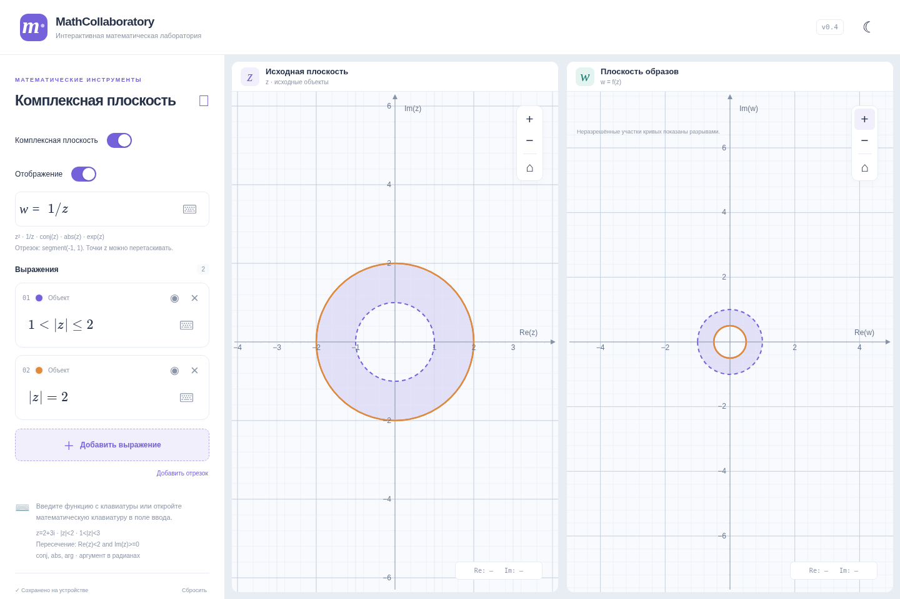
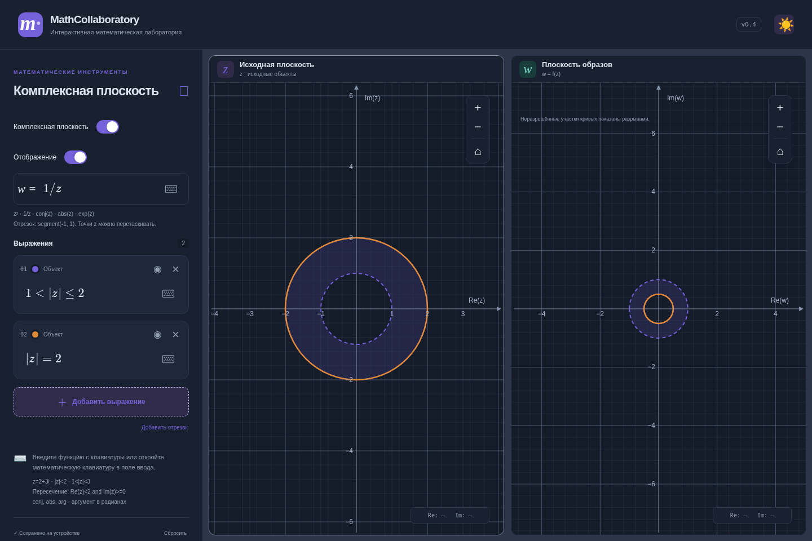
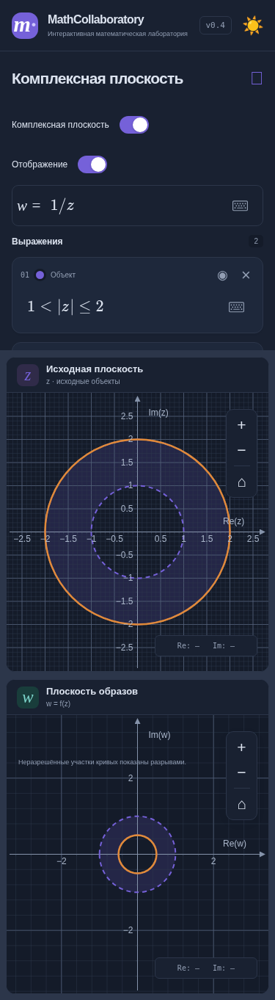

# v0.4 — области и математический ввод

Основа: актуальный main `d6ed11e`, включающий объединённый PR #4 (v0.3). Ветка `feature/complex-regions-v0.4` не зависит от незавершённых PR. Новых зависимостей нет.

## Математический ввод

В реальном браузере ввод `1`, `/`, `2` через клавиатуру MathLive 0.111.4 возвращает `\frac12`. Прежний преобразователь требовал группы `{…}` и выдавал «Ожидаются фигурные скобки». Проверены фактические значения MathLive для обычных дробей, dfrac, tfrac и вложенных дробей.

Преобразователи комплексного и вещественного режимов принимают `\frac{a}{b}`, `\dfrac{a}{b}`, `\tfrac{a}{b}` и допустимые однотокенные аргументы TeX: `\frac12`, `\frac1z`, `\frac1{z+1}`. Отсутствующие/пустые аргументы диагностируются. Корни и остальные правила вещественного парсера сохранены.

Формулы отображения:

- `(z+1/z)/2`, `1/2 (z+1/z)` — функция Жуковского.
- `1/2 (1+1/z)` — другая функция; не переписывается в функцию Жуковского.
- `\frac12\left(z+\frac{1}{z}\right)`.
- `\dfrac{z+\frac{1}{z}}{2}`.
- `\frac{1}{\frac{z+1}{2}}`.

Для Жуковского проверены несколько комплексных и отрицательных значений z; при нуле — неопределённое значение, без сбоя приложения. Произвольные mathjs evaluate/compile не используются, прежние лимиты 500 символов и AST сохранены.

## Синтаксис областей

| Запись | Область |
| --- | --- |
| `Re(z)<2`, `Re(z)>=2` | Вертикальные полуплоскости |
| `Im(z)>0`, `Im(z)<=0` | Горизонтальные полуплоскости |
| `\|z\|<2`, `\|z\|<=2` | Открытый/замкнутый диск |
| `\|z-(1+i)\|<2`, `\|z-1-i\|<2` | Диск со смещённым центром |
| `1<\|z\|<3`, `1<=\|z\|<=3` | Кольцо |
| `Re(z)<2 and Im(z)>=0` | Пересечение |
| `1<\|z\|<=3 and Re(z)>0` | Полукольцо |

Пересечение задаётся **двумя условиями через `and`**, либо LaTeX `\land` / `\wedge`. Каждое условие может быть двусторонним радиальным неравенством; суммарно не более четырёх границ. Поддержаны `\le`, `\leq`, `\ge`, `\geq`, ≤, ≥. В виртуальную клавиатуру комплексного режима добавлены сравнения и пересечение.

Области разбираются через mathjs OperatorNode/RelationalNode, а не отдельные регулярные выражения для каждого примера. Круговые условия принимают только одно z с коэффициентом +1 и постоянным смещением, как окружности v0.2.1. Нелинейные условия, произвольные функции, дизъюнкция и дополнительные переменные отклоняются. Радиусы должны быть положительными; геометрия вне доступной числовой точности диагностируется.

Строгая граница пунктирная, нестрогая сплошная. Полупрозрачность заливки — 0.17. Несколько областей сохраняют собственные цвета; их пересечения видны. Геометрия, сетка и оси остаются поверх заливки.

## Архитектура

- `src/regions/model.ts`: область как пересечение обобщённых круговых неравенств `a|z|²+b Re(z)+c Im(z)+d <(=) 0`, плюс исключённые конечные точки; чистая проверка принадлежности и выделение геометрической границы.
- `src/regions/parse.ts`: ограниченный структурный разбор неравенств. Общий разбор смещения окружности вынесен без изменения алгоритма в `src/complex/offset.ts`.
- `src/regions/transform.ts`: структурное распознавание аналитически поддерживаемых отображений и преобразование областей независимо от React/JSXGraph.
- `src/regions/render.ts`: точные SVG-окружности и отсечение полуплоскостей, встроенные в слои JSXGraph. Вложенные clipPath дают пересечение условий. Границы отсекаются другими условиями; рамка viewport не выдаётся за математическую границу.
- `useImagePlots` передаёт образ области общему слою объектов. `ComplexWorkspace` показывает ограничения и пояснение исключённых точек.

При pan/zoom/resize обновляются координаты существующих SVG-узлов. Число узлов зависит от числа условий, а не площади окна или масштаба: нет сетки треугольников, отдельного узла на пиксель или неограниченного цикла вычислений. Области не пересоздают доски, CSS-анимации и равный масштаб Re/Im v0.3 сохранены.

Также исправлен обнаруженный дефект v0.3: обновление закрытой кривой образа могло включить сплошную заливку JSXGraph. Теперь у кривых явно задана нулевая fillOpacity, у точек сохранена непрозрачная заливка.

## Точные образы на w-плоскости

Для структурно распознанных невырожденных преобразований Мёбиуса `(az+b)/(cz+d)` и их вариантов с сопряжением используется обратная подстановка в неравенство. Поддержаны, например, `z`, `z+1`, `2z-1`, `i*z`, `1/z`, `(z-1)/(z+1)`, `conj(z)`, `1/(conj(z)-1)`. Разбор консервативный: не все алгебраически эквивалентные записи распознаются.

Это преобразование всей области, включая неограниченные полуплоскости и внешности дисков; видимое окно ограничивает только отрисовку результата. Внутренность образа границы не используется как предположение о принадлежности.

Примеры:

- `\|z\|<2`, `1/z` → `\|w\|>1/2`; полюс z=0 не создаёт фиктивной точки.
- `\|z\|>=2`, `1/z` → `0<\|w\|<=1/2`.
- `Re(z)>=0`, `1/z` → `Re(w)>=0`, исключая w=0.
- `\|z-1\|<=1`, `1/z` → `Re(w)>=1/2`.
- `Im(z)>0`, `conj(z)` → `Im(w)<0`.

Сохраняются строгие/нестрогие границы и пересечения. Отсутствующий конечный образ бесконечности исключается явно. Отдельно сохраняются дыры области определения исходной записи: `1/(1/z)` не превращается в тождественную функцию с восстановленной точкой z=0. Видимые исключённые точки отмечены полыми кружками фиксированного экранного размера; это условное обозначение, а не исключение целого диска вокруг точки.

Для `z^2` и `z^3` точно поддержаны диски, внешности и кольца с центром в нуле, включая пересечения радиальных условий. Радиусы преобразуются в r²/r³. Открытость и замкнутость сохраняются.

## Границы этого этапа

Общий численный алгоритм закраски образов намеренно не добавлен. Для неинъективной функции образ границы и конечная выборка внутренности не гарантируют правильный образ области, особенно с полюсами или неограниченным источником. В соответствии с дополнением к заданию реализовано проверяемое аналитическое подмножество.

Для `exp`, `sin`, `cos`, `abs`, функции Жуковского, смещённых дисков/полуплоскостей при z² и прочих неподдерживаемых комбинаций **образ области не закрашивается**. На w-плоскости появляется сообщение об ограничении. Исходная область остаётся видимой; точки и кривые отображаются прежним алгоритмом v0.3. Нет выдачи конечного фрагмента источника за полный образ и нет заведомо неверной сплошной заливки.

Проверка принадлежности и коэффициенты используют floating point. Если вычисленная граница вырождается или не представима с доступной точностью, выводится диагностика. Рендерер использует SVG-слои установленной версии JSXGraph; альтернативные Canvas/VML-рендереры не поддерживаются. Это соответствует существующей SVG-конфигурации приложения.

## Сохранение и проверки

Формат хранения `mathcollaboratory.v1`, version=1 не изменён. Области хранятся прежними строками выражений, поэтому v0.3 и более ранние сохранения восстанавливаются без миграции структуры. Проверены некорректная редактируемая запись, повторный reload, независимые настройки режимов/плоскостей, цвет и видимость.

- 323 модульных тестов, включая все 233 теста v0.3.
- 34 браузерных сценария Chromium, включая все 30 прежних.
- WebKit-проект расширен до 13 сценариев (навигация, отображения, области); результат CI указан в PR. Локальный запуск ограничен отсутствующими libgtk-4, libgraphene, libharfbuzz-icu, libmanette, libhyphen и libGLESv2.
- TypeScript, production build и diff --check.

Новые тесты проверяют численные значения дробей и Жуковского, реальный клавиатурный ввод `\frac12`, открытые/замкнутые границы, смещённые диски, кольца, пересечения, полюса и устранимые дыры, преобразования Мёбиуса/сопряжение, радиальные z², аналитическую принадлежность на сетке точек, неподдерживаемые случаи, pan/zoom, количество SVG-узлов, сохранение, цвета, обе темы и мобильный экран.

Прежние предупреждения сборки о размере JS и eval внутри JSXGraph остаются. Реальные Safari/iOS и физические жесты устройств не проверялись.

## Снимки

