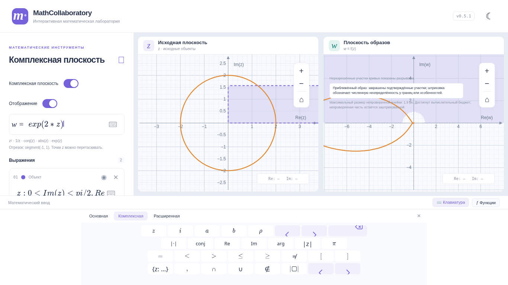
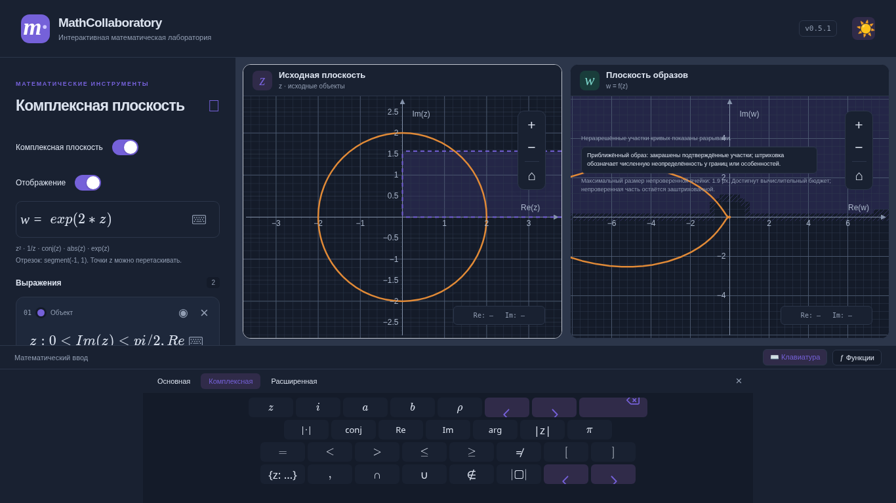
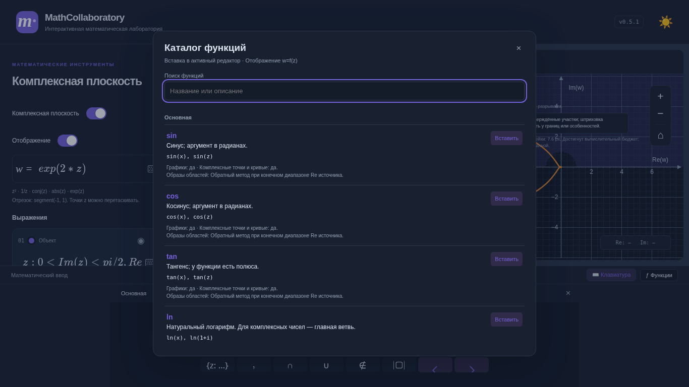

# v0.5.1 — обратный движок образов и компактный ввод

Основа: актуальный main `f8d38f2` с объединённой v0.5 (PR #7). Ветка: `feature/mapping-engine-keyboard-v0.5.1`. Новых зависимостей, серверов и изменений формата localStorage нет. PR не объединяет и не публикует приложение.

## Результаты аудита

Каноническая `exp(2*z)` уже работала на main для `{z:0<Im(z)<pi/2,Re(z)>0}`. Это подтверждено проверкой всей цепочки MathLive → преобразование LaTeX → mathjs AST → обратные прообразы → SVG. Контрольные точки образа проверяются относительно **|w|>1 и Im(w)>0**, включая строгую границу, ноль и далёкие точки, не зависящие от видимого окна z.

Системные ограничения находились между вычислителем точек и распознавателем семейств областей:

- `e^{2z}`, эквивалентная экспоненте, не получала обратного плана; вычислитель также требовал целого показателя для основания e.
- План описывал одно семейство, поэтому композиции `exp(z^2)`, `1/(z^2+1)`, `(z^2+1)/(z^2-1)`, `sin(z)` и другие вычислялись для точек/кривых, но не строились как образы областей.
- Аффинный аргумент exp ограничивался прямоугольником x/y: конечная ширина наклонной полосы могла теряться.
- В численной ветке не учитывались исключённые точки, возникающие при сокращениях Мёбиуса, например `1/(1/z)`. Точный путь их сохранял.
- Изменение только цвета сбрасывало кэш численного построения. Один большой синхронный sampler мог занимать целый кадр и больше.

Эти причины исправлены в общих компонентах, без правил под отдельную учебную задачу.

## Вычислительная архитектура

`math/operations.ts` — общий реестр фиксированных операций, LaTeX-шаблонов, описаний и доступности. Его используют оба ограниченных вычислителя, клавиатура и каталог. Добавлены реальные/комплексные обратные тригонометрические и гиперболические функции, главные sqrt/ln/log; floor/ceil/round доступны только для вещественных графиков. Пользовательский AST никогда не передаётся в evaluate/compile. Вызовы унаследованных свойств, включая constructor, исключены и проверяются тестами.

`regions/pipeline.ts` структурно раскладывает AST в последовательность обратимых по ветвям ступеней. Сохраняются аналитические Мёбиус/сопряжение и радиальные степени. Композиции дополняют их, вместо отдельного sampler для каждой формулы:

- Мёбиус, сопряжение, постоянные аффинные преобразования, целые степени 1…32 и обратные степени.
- `exp(a*z+b)` и эквивалентная запись `e^(a*z+b)`; exp может применяться к другой поддерживаемой функции.
- Жуковский и рациональные функции от одного общего внутреннего выражения.
- `cos u = J(exp(i*u))`, `sin u = J(exp(i*u-i*pi/2))`, где J(t)=(t+1/t)/2.
- `tan u = -i*(exp(2i*u)-1)/(exp(2i*u)+1)`.

План ограничен 12 ступенями и 128 суммарными обратными ветвями; на ступень exp — до 32 ветвей логарифма. Верхняя оценка ветвей намеренно консервативна. Для очередного exp нужны конечные границы Im его аргумента, выведенные из **всей математической области** и консервативных ограждений предыдущих ступеней. Исходный viewport не обрезает поиск. Линейные ограничения учитывают также наклонные полосы. Если достаточно узкое ограждение не удалось получить, отображение объясняет ограничение и не подставляет произвольный конечный диапазон.

`regions/inverse.ts` проверяет принцип **w∈f(D) ⇔ существует допустимый z∈D: f(z)=w**. Обратные ступени обходятся в противоположном порядке, с перечислением корней/логарифмических ветвей. Все условия D проверяются на одном прообразе. Исключение одного корня не исключает значение w, если есть другой разрешённый корень. Учитываются полюса и устранимые дырки исходной записи. Переполнение и потеря возможности оградить ветвь дают неопределённость.

Для заливки используются ограждения **целых целевых ячеек**, а не голосование по точкам и не внутренняя часть образа границы. Адаптивное дерево делит сомнительные ячейки. Точечный свидетель может запросить дополнительное уточнение тонкого участка до 0.4 экранного пикселя, но не разрешает его закрасить. Ячейка закрашивается только после проверки всего ограждения. У непроверенных участков отдельная штриховка; это не часть подтверждённой заливки. Точные аналитические результаты, численные изображения и неопределённость различаются в интерфейсе.

Математическая проверка остаётся вычислением double с консервативными ограждениями и защитным запасом. Это не формально верифицированная интервальная арифметика и не доказательство полноты растрового изображения. Точная строгость границы остаётся в модели; численное изображение не обещает показать границу нулевой толщины или все сколь угодно тонкие компоненты.

## Отзывчивость и кэш

Математическая задача допускает возобновление маленькими порциями. SVG-слой обрабатывает пачки до 32 ячеек, старается уступать главный поток через 8 мс и проверяет поколение задачи между кадрами. Новая формула, параметр или viewport отменяет продолжение старой задачи. Уже вычисленные математические ячейки перепроецируются при перемещении, без пересоздания досок JSXGraph.

Сохранены быстрый режим (до 512 ячеек) и уточнение после 180 мс покоя (до 6144, с общим бюджетом, учитывающим количество областей/ветвей/условий). Очереди, число ячеек, глубина AST и обратные ветви ограничены. Цвет меняет атрибуты SVG и не пересчитывает геометрию. SVG использует два path и один шаблон штриховки на численную область; количество узлов не зависит от количества ячеек. Workers не добавлены: ограниченные порции уже позволяют отменять работу и обслуживать ввод между кадрами. Одна тяжёлая порция или сборка мусора всё ещё может превысить целевые 8 мс.

Сравнительный CPU-замер: `node scripts/benchmark-region-images.mjs f8d38f2`. Node 24.22.1, одинаковый viewport [-5,5,5,-5], 60 px/ед., бюджет 4096; медиана 10 замеров после прогрева на одной машине:

| Сцена | v0.5, мс | v0.5.1, мс | Максимальная непроверенная ячейка, px |
|---|---:|---:|---:|
| Полуполоса, exp(2z) | 4.59 | 10.60 | 1.17 → 1.17 |
| Кольцо, exp(z) | 5.62 | 8.17 | 2.34 → 2.34 |
| Сектор с исключением, z⁸ | 16.90 | 29.15 | 1.17 → 0.59 |

Полный расчёт стал дороже из-за проверок и дополнительной детализации. Улучшение интерактивности обеспечивается разбиением работы и отменой, а не заявлением об ускорении сырого sampler. Для сектора подтверждённых ячеек стало 2056 вместо 1254. Время зависит от нагрузки и не используется как нестабильный порог в тестах. Счётчик непроверенных ячеек может расти при их более мелком делении; он не означает площадь ошибки.

## Клавиатура и каталог

Виртуальная клавиатура открывается явно кнопкой внизу или стандартным значком MathLive. Компактная панель высотой 205 px резервирует место под графиками. Для ноутбука 1366×768 тест проверяет отсутствие перекрытия, видимость всех клавиш и достаточную высоту графика. Существующая мобильная адаптация сохранена.

Категории: «Основная», «Комплексная», «Расширенная». Во вещественном режиме комплексные операции скрыты. Нативные клавиши и команды MathLive сохранены. Смена категории удерживает позицию курсора; категориями можно управлять стрелками. Escape закрывает клавиатуру и возвращает редактор. При открытом диалоге Escape относится к диалогу. Анимация 160 мс отключается при reduced motion. Производных, интегралов и неподдерживаемых корней произвольной степени в клавиатуре нет.

Кнопка «Функции» открывает доступный модальный каталог с поиском по названию, псевдониму и описанию. Показаны примеры и доступность для графиков, комплексных точек/кривых и заливки областей. Вставка возвращается в последний активный MathLive, включая сохранённое выделение: выбор 2 в 1+2 и вставка sin даёт 1+sin(2). Недоступные в текущем контексте операции нельзя вставить. Списки функций и математические реализации берутся из общего реестра.

## Совместимость и ограничения

localStorage остаётся `mathcollaboratory.v1`, version 1. Формулы, параметры, оба списка, независимые viewport и состояние отображения используют прежний формат. Восстановление старых значений параметров отделено от запрета новых имён функций: если старое имя совпало с новой функцией, данные и формула сохраняются, а парсер сообщает конфликт имени. Автоматическое переименование, способное изменить смысл выражения, не выполняется.

Пока отсутствует общий сертифицированный решатель произвольного уравнения f(z)=w. Например, `exp(z)+z` и общий полином `z^2+z` вычисляются для точек/кривых, но не получают ложную заливку. Рациональные функции поддержаны через распознаваемые семейства и композиции, а не через все возможные полиномы числителя/знаменателя. Неподдерживаемые структуры получают конкретное сообщение о недостающем обратном плане. Безусловный поиск методом Ньютона не добавлен: он не доказывает отсутствие других прообразов.

`sin/cos/tan` требуют конечного числа периодических ветвей, как и exp. Например, sin на ограниченном диске поддержан; sin на всей неограниченной по Re полуплоскости может потребовать бесконечного поиска. Заливка главных ln/log/sqrt и обратных тригонометрических функций пока не реализована. `abs`, Re, Im, arg имеют одномерный образ — двумерная заливка к ним не применяется. Объединения разных одномерных границ с площадями сохраняют прежнее явное ограничение. Общий AST-вычислитель не стал произвольным исполняемым mathjs.

Следующий этап: более тесные ограждения промежуточных областей, сертифицированные обратные ветви для ln/sqrt, расширение рациональных семейств с проверкой полноты корней; worker понадобится при росте стоимости одной ограниченной порции. Реестр операций можно использовать в будущей справке; новый раздел настроек в этом PR не создаётся.

## Проверки и снимки

Математические тесты сравнивают принадлежность контрольных точек, открытые/замкнутые границы, несколько прообразов, исключённые множества и независимые прямые значения. Покрыты exp-полосы, степени 2/3/4/8, Жуковский, композиции, тригонометрия, полюса, переполнение, параметры, ограниченные бюджеты и равенство возобновляемого/непрерывного расчёта. Есть проверки всех рекламируемых в каталоге шаблонов, безопасности реестра и старых сохранений.

Браузерные тесты проверяют фактические клавиши MathLive, позицию курсора, каталог и физический ввод; также SVG-принадлежность точек образу полуполосы, отсутствие пересчёта при смене цвета, отмену устаревшей работы, перезагрузку, темы и reduced motion. Существующие регрессии v0.1.1–v0.5 сохранены. Окончательные результаты полного CI приводятся в PR.

