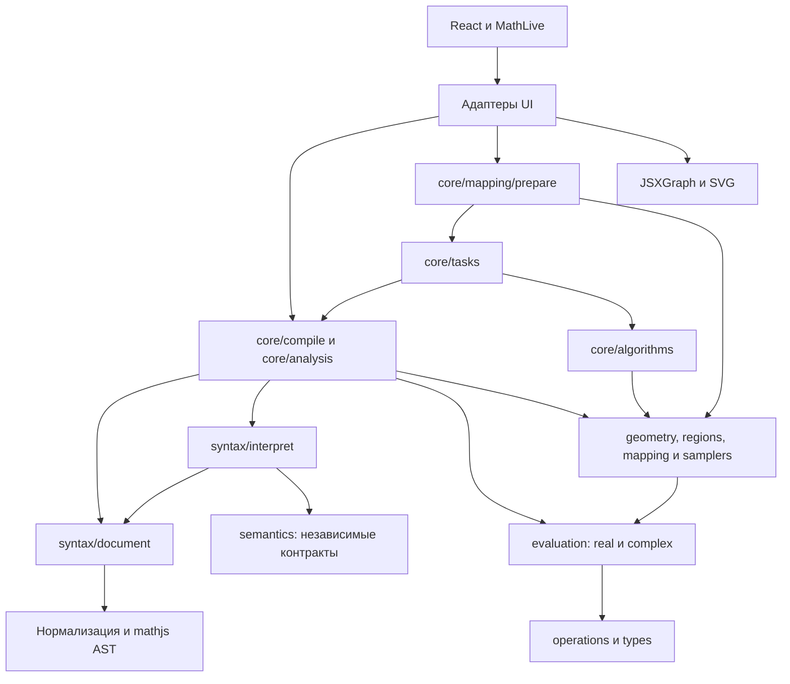

# MathCollaboratory v0.6 — фундамент математического ядра

Ветка `feature/math-core-v0.6` создана от актуального main `3bf4a65`, содержащего объединённую v0.5.1 (PR #8). Изменение посвящено архитектуре: внешний вид, клавиатура, темы, навигация и мобильная компоновка сохранены. Новых зависимостей, серверов и Workers нет.

## Аудит и выполненный план миграции

До изменения проверены цепочки MathLive → LaTeX → mathjs AST → вычисление/параметры → геометрия/обратные ветви → выборка → SVG. Основные проблемы:

1. Вещественная и комплексная нормализация находились вместе с исполнителями. Обход AST повторялся при поиске параметров и построении программы; изменение параметров заново разбирало комплексные формулы.
2. Числовые типы были объявлены в `complex/geometry`, математический viewport — в состоянии приложения. Подготовка численных образов, бюджеты и их кэш были частью React-хука; математическое отсечение полуплоскости находилось в SVG-рендерере.
3. Интерфейсы возвращали `NaN`, `null`, исключение или строковый статус точности. «Аналитический метод» и «математически точные числовые коэффициенты» явно не разделялись.
4. Реестр вычислимых функций содержал оформление и шаблоны MathLive. Общего контракта независимых вычислительных задач не было.

Миграция выполнена по этапам. После переноса чистых модулей прошли все 480 старых модульных тестов. После разделения AST и параметрических программ они прошли повторно. Затем добавлены новые API, семантика, результаты и задачи с собственными математическими проверками. Старые точки входа не удалены.

## Слои и зависимости



Стрелки обозначают зависимости модулей; возврат данных в UI не является обратным импортом ядром интерфейса.

Обратных зависимостей ядра от UI, DOM, SVG, MathLive, JSXGraph или localStorage нет. `tsconfig.core.json` собирает `src/core` только с `lib: ES2022`, без DOM и типов браузерных библиотек. Архитектурный тест проверяет импорты ядра, отсутствие вызовов произвольного mathjs evaluate/compile и независимость семантических контрактов от AST. Публичный API импортируется в обычном Node-окружении тестов.

| Модуль | Ответственность |
|---|---|
| `core/types.ts` | Координаты, математический viewport, вещественный scope |
| `core/syntax` | Адаптеры LaTeX, ограниченный AST, нормализованный документ, интерпретация в семантические структуры |
| `core/semantics.ts` | Независимые типы объектов, отношений, множеств, условий определения и особенностей |
| `core/operations.ts` | Только фиксированные реализации и доступность операций, без оформления клавиатуры |
| `core/evaluation` | Специализированные контролируемые real/complex исполнители и вещественная выборка |
| `core/compile.ts` | Компиляция, проверка параметров, привязка и вычисление через согласованные интерфейсы |
| `core/domain.ts` | Структурные условия области определения и проверка в точке |
| `core/geometry`, `core/regions` | Точки/кривые/области, параметры границ, отсечение, преобразования и обратные ветви |
| `core/mapping/prepare.ts` | Подготовка образов, вычислительные бюджеты и кэш без React и цвета |
| `core/results.ts` | Математический результат, диагностика, точность и расход бюджета |
| `core/algorithms.ts` | Типизированные контракты и реестр реально существующих методов |
| `core/tasks.ts` | Снимки заданий, последовательные порции работы, отмена и сериализуемые ответы |
| `core/index.ts` | Публичная поверхность API |

## Промежуточное представление и семантика

`MathDocument` хранит исходный `ExpressionSource`, нормализованный текст, неизменяемый mathjs AST, роль выражения, разрешённые переменные, параметры и стоимость структуры. Роли — вещественное выражение, комплексный скаляр, отображение и геометрия. Строковые точки входа по умолчанию принимают прежнюю LaTeX-нотацию; явная `notation: 'expression'` принимает каноническую запись.

AST остаётся синтаксическим представлением. `syntax/interpret` строит другой, независимый от mathjs слой:

- скаляр в вещественном или комплексном поле;
- геометрическое определение через равенство/неравенство, цепочку сравнений, пересечение или объединение;
- исключённую точку или отрезок;
- условия области определения и сведения об особенностях.

Скалярные части представлены ссылками на проверенные подвыражения, а не вторым символьным деревом арифметики. Ссылки имеют полный путь в AST и канонический текст. Собственный структурный обход нужен потому, что mathjs traverse сообщает локальные пути детей. Наличие полного пути проверяется независимо: тест разрешает его по полям AST и сравнивает подвыражение.

Открытый интерфейс `MathematicalObjects` и общий `SemanticObjectBase` допускают дальнейшее добавление систем, ОДУ и других типов без изменения арифметического AST. Решатели этих объектов сейчас не объявляются доступными. После привязки параметров геометрия представлена прежними независимыми типами `ComplexGeometry` и `Region`.

Нормализация не выполняет алгебраического упрощения. Например, у `1/(1/z)` сохраняются исходные ограничения, включая z=0, хотя формулу можно было бы формально сократить до z. Цепочки угловых сравнений не разворачиваются в обычную логическую формулу с другим соглашением об Arg: семантическая модель сохраняет соглашение языка v0.5.1, а геометрический алгоритм остаётся прежним.

## Компиляция и параметры

Публичные операции разделены:

- `compileReal`, `compileComplex`, `compileMapping`, `compileGeometry` — структура и проверка, без подстановки изменяющихся параметров;
- `evaluateReal`, `evaluateComplex`, `evaluateMapping`, `evaluateGeometry` — вычисление и типизированный математический результат;
- `bindMapping`, `bindGeometry` — параметрическая привязка существующих алгоритмов;
- `analyzeDomain`, `checkDomain` — сведения об области определения и её отдельная проверка;
- `mapRegionImage`, `checkImageMembership`, `checkRegionMembership` — специализированные геометрические операции;
- `prepareRegionImageTask` — подготовка ограниченной численной задачи.

Компиляция/привязка возвращает `Validation`, математическое вычисление — `MathResult`. Невозможность проверить или поддержать действие не маскируется числом.

```ts
import {compileMapping, evaluateMapping} from './core';

const compiled = compileMapping('a*z^2');
if (compiled.ok) {
  const first = evaluateMapping(compiled.value, {re: 1, im: 1}, {a: 2});
  const second = evaluateMapping(compiled.value, {re: 1, im: 1}, {a: 3});
  // approximate: 4i и 6i. Один документ, AST и исполняемая программа.
}
```

Два ограниченных кэша хранят до 256 AST и 128 документов. Исполняемые программы индексируются по AST/документу через WeakMap. В комплексном исполнителе scope передаётся явно, а не захватывается как изменяемое глобальное окружение. Преобразованные константы параметров переиспользуются и неизменяемы внутри кэша. Старый API получает отдельные изменяемые Complex-значения, поэтому их изменение не портит последующие вычисления. Привязка отображения делает независимый неизменяемый снимок нужных значений. Попеременное вычисление двух привязок проверяется тестом, чтобы значения не перетекали между ними.

Геометрическая программа разбирает структуру один раз и при изменении параметров вычисляет центр, радиус или коэффициенты условий. Пересчёт семейства отображения при изменении его параметра остаётся необходимым; повторный синтаксический разбор не нужен. Кэш рабочего пространства учитывает только зависимости конкретной формулы. Геометрические идентификаторы и внутренняя запись отображения разделены по пространствам имён.

В горячих циклах выборки сохранены специализированные числовые функции `fast`, не создающие объект MathResult для каждого пикселя. Они не предоставляют гарантию точности; их прежние NaN/null-соглашения адаптируются на границе. Обычные вызовы публичных evaluate-функций возвращают структурированный результат.

## Области определения и особенности

Анализ извлекает условия ненулевого знаменателя, ограничения ln/log/sqrt, вещественных asin/acos, целых комплексных степеней и полюсов tan/tanh/atan. Он сохраняет кандидатов на особые точки, информацию о главных ветвях, неголоморфных операциях и разрывах округления.

Это **область вычисления выражения**, а не автоматическое доказательство голоморфности. Например, значение главного комплексного ln на отрицательной вещественной оси может вычисляться по существующему соглашению, одновременно присутствует сообщение о разрезе. «Кандидат на полюс» не утверждает, что полюс доказан: после сокращения может остаться исключённая точка исходной записи.

Условия не решаются символически. Для геометрических определений анализ области вычисления помечен частичным; принадлежность самой области проверяется отдельной операцией. Вблизи полюса эвристический допуск приводит к неопределённости, а не к строгой гарантии. Переполнение exp и отсутствие математического значения разделены: exp(1000) может быть математически определено при невозможности представить результат в float64.

## Результаты и гарантии

| `MathResult.kind` | Смысл |
|---|---|
| `analytic` | Точный символьный аналитический результат; требуется `ExactAnalyticEvidence` |
| `approximate` | Численный результат float64, `certified: false`, `absoluteErrorBound: null` |
| `interval-confirmed` | Верифицированное интервальное ограждение; обязательны backend, направленное округление и ссылка на свидетельство |
| `uncertain` | Недостаточная точность, переполнение, незавершённый бюджет или отмена; возможен частичный результат |
| `unsupported` | Математическая операция или тип объекта пока не поддержаны |
| `input-error` | Некорректный ввод, точка или параметры |

Текущая версия **не производит** `analytic` с точным символьным свидетельством и `interval-confirmed`: соответствующих backend пока нет. Их типы предусмотрены без фиктивных исполнителей.

Аналитическая формула не равна точности вычисленных чисел. Например, закон преобразования Мёбиуса известен аналитически, но коэффициенты области вычисляются обычной арифметикой. Новый API возвращает `approximate` с отдельным `derivation: {kind: 'analytic-formula', law: ...}`. Это относится и к готовой геометрической форме `analytic-region` в данных задачи: название формы описывает метод/представление, а гарантия находится в MathResult.

Существующие обратные ограждения используют эвристические запасы float64. Даже если все ячейки приняты классификатором, результат остаётся приближённым. Если есть неразрешённые ячейки, задача возвращает `uncertain` с частичными данными, причиной и расходом бюджета. Старые строковые статусы интерфейса оставлены для визуальной совместимости; потребители нового API должны использовать новую модель гарантий.

## Алгоритмы и задачи

Реестр содержит только существующие методы: аналитические семейства с численным обратным планом, принадлежность геометрической области, обратную проверку прообразов и адаптивное разбиение. `defineAlgorithm<Input, Output>` задаёт контракт специализированного метода. Категории для решения уравнений, интервалов, интегрирования, дифференцирования и ОДУ предусмотрены, но такие методы не зарегистрированы.

Сериализуемая `RegionImageRequest` включает schema, id, исходную область, определение отображения, параметры, целевой viewport, масштаб, точность и бюджет. В неё не входят mathjs AST, функции, JSXGraph board и внутренние обратные планы с бесконечными границами. `TaskRequestBase` и `ComputationTask<Result, Input>` допускают другие будущие типы заданий.

Публичная подготовка проверяет JSON-совместимость, форму области, конечность входных данных, размеры и бюджет 1…12000. Входной снимок копируется и замораживается; дальнейшее изменение вызывающим кодом исходного объекта не меняет вычисление. Ответы и частичные данные проходят JSON-round-trip в тестах, включая аналитически полученные области с исключёнными точками. Выявленные экземпляры mathjs.Complex на границе геометрической модели заменены обычными координатами.

Задача продолжает расчёт ограниченной порцией и поддерживает отмену. После отмены незавершённой задачи не выдаётся старое частичное изображение. В SVG-адаптере сохранён прежний цикл requestAnimationFrame и проверка поколения; теперь он также явно отменяет старую задачу ядра. **Новый планировщик и Workers не реализованы**. Для их добавления достаточно внешнего транспорта и управления существующими сообщениями; вычислительное ядро не требует DOM.

Сейчас сериализуемая оболочка реализована для областей. Вещественная и параметрическая выборка уже находятся в чистом ядре, но сохраняют старые быстрые интерфейсы; отдельные сообщения Worker для них — следующий этап.

## Что сохранено и почему

- Старые пути `math/*`, вычислительные `complex/*`, `mapping/*` и `regions/*` переэкспортируют реализации ядра. Внешние вызовы и прежние тесты не требуется переписывать одновременно с архитектурой.
- Два специализированных вычислителя сохранены. Вещественные и комплексные операции имеют разные области и существующие соглашения; объединение в один универсальный evaluator могло бы изменить смысл выражений.
- Два адаптера LaTeX сохранены: вещественная запись допускает произведение соседних букв, комплексная — длинные имена параметров и геометрические условия. Общими стали ограниченный AST, реестр функций, нормализация имён и контракты. Полное объединение грамматик отложено до отдельного проекта синтаксиса.
- Примитивы Region, аналитические семейства, обратные формулы, адаптивные samplers и их лимиты перенесены без замены математических алгоритмов.
- JSXGraph, SVG, MathLive, физические клавиши, клавиатура, темы и мобильная компоновка сохранены. Из React убраны математический кэш, бюджеты и подготовка образов; цвет и собственно отрисовка остаются снаружи ядра.
- localStorage остаётся `mathcollaboratory.v1`, version 1. Выражения, параметры и viewport имеют прежний формат; миграция не нужна. Кэши и задания не сохраняются.

## Проверки и измерения

Новые проверки сравнивают математические свойства, а не снимки:

- эквивалентность степеней тригонометрических функций, вложенных дробей, функции Жуковского, экспоненты и Euler-записи при нескольких точках;
- сохранение исключений и углового соглашения после канонической нормализации;
- ненулевые знаменатели, главные ветви, полюса и численную неопределённость;
- одну структуру/программу при изменении параметров и независимость одновременных привязок;
- согласие нового API со старыми числовыми и геометрическими точками входа;
- строгое разделение приближённых и верифицированных статусов;
- обратные ветви, JSON-совместимость задач и результатов, отмену, снимки данных, ограниченный бюджет;
- отсутствие зависимостей ядра от UI и независимость семантической модели от mathjs AST.

Команды: `pnpm test`, `pnpm typecheck`, `pnpm typecheck:core`, `pnpm test:browser`, `pnpm build`. Полный локальный Chromium сохраняет все 48 сценариев; Chromium и WebKit проверяются также в GitHub Actions. Окончательные результаты текущего коммита приведены в PR.

Скрипт `node scripts/benchmark-core.mjs 3bf4a65` восстанавливает старый код в отдельный временный каталог и сравнивает его с текущим ядром на одной машине. Node 24.22.1, медиана семи замеров после двух прогревов; контрольные суммы совпадают:

| Нагрузка | v0.5.1, мс | v0.6, мс |
|---|---:|---:|
| 50 000 вещественных значений | 29.001 | 8.653 |
| 10 000 комплексных значений | 5.898 | 6.537 |
| 400 изменений параметров отображения | 18.043 | 16.620 |
| 400 изменений параметров области | 10.766 | 2.666 |

Для 100 дополнительных привязок отображения число новых разборов AST — **0**. Комплексный цикл в этом замере медленнее на 0.639 мс на 10 000 значений (около 11%); повторная привязка областей заметно дешевле. Замеры зависят от JIT, сборки мусора и нагрузки; они не доказывают универсальное ускорение. Скрипт сохранён для воспроизведения. Прежний benchmark численных областей также остаётся доступным и обновлён для новой структуры модулей.

## Ограничения и следующие этапы

Ядро не является CAS и не решает произвольные f(z)=w. Прежние ограничения семейств, числа обратных ветвей, сложных областей и численной детализации сохранены. Анализ области определения структурный и частичный в общих случаях; он не является доказательством полноты множества решений или голоморфности.

Следующие этапы: отдельные семантические объекты систем/ОДУ и их реальные алгоритмы; верифицированный интервальный backend с направленным округлением; транспорт задач в Workers и управление поколениями сообщений; сериализуемые контракты для остальных samplers; дальнейшая унификация синтаксиса с сохранением прежних соглашений. Каждый этап может добавляться отдельно с математическими тестами, без переписывания React и JSXGraph.
