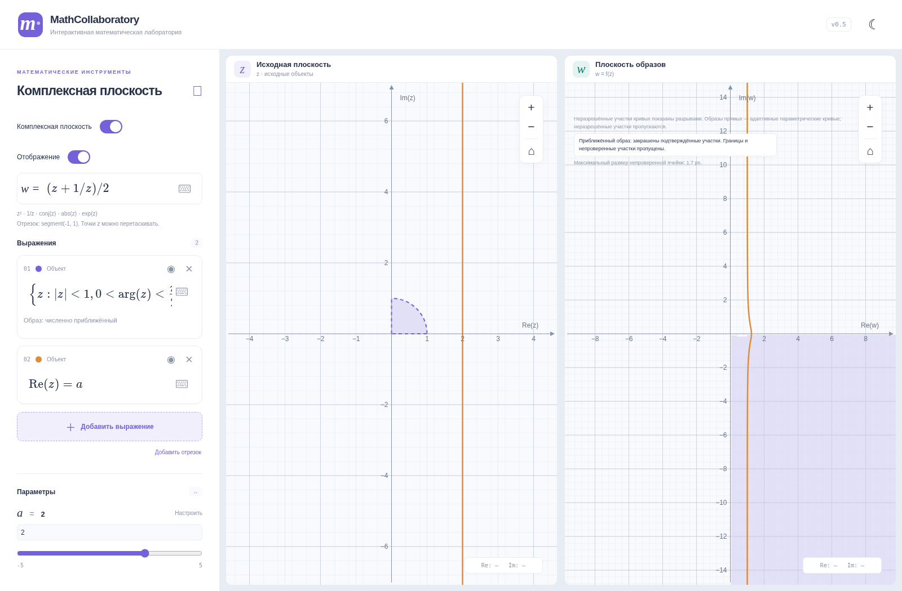
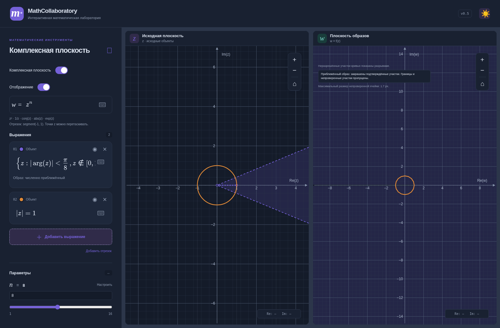
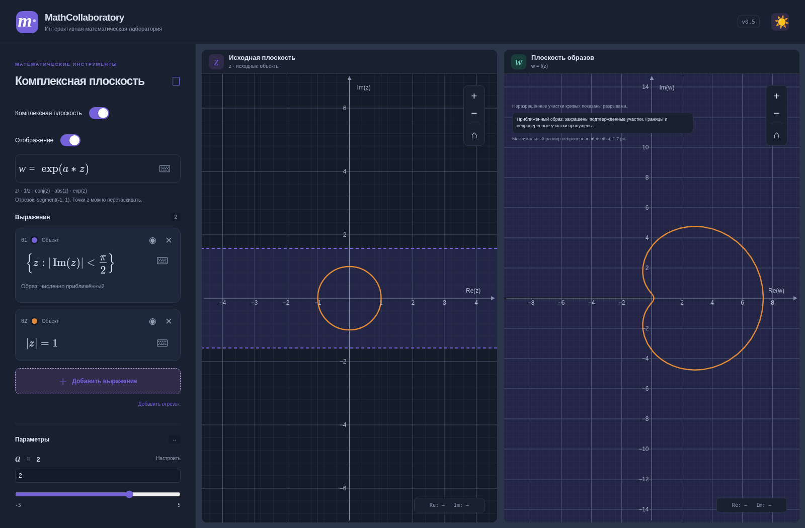

# v0.5 — параметры и ТФКП

Ветка `feature/tfkp-engine-v0.5` начата от main `510d909`, содержащего объединённую v0.4.1 (PR #6). Новых зависимостей и серверных сервисов нет. Вещественный калькулятор, обе комплексные плоскости, MathLive, темы и анимации сохранены. Новые UI-проверки ориентированы на desktop; прежняя мобильная адаптация и её регрессионные тесты оставлены.

## Параметры и константы

Поддерживаются вещественные параметры в точках, линиях/окружностях, условиях области и формуле отображения: `Re(z)=a`, `Im(z)>a`, `|z|=rho`, `|z-a|<r`, `w=a*z+b`, `w=exp(a*z)`, `w=z^n`. Допускаются имена до 16 букв/цифр/подчёркиваний с первой буквой и индексы MathLive `a_{1}`. `\rho` соответствует rho.

Неизвестные параметры получают предложение «Создать ползунок». Реальные и комплексные выражения используют общий словарь: один a меняет все зависимые объекты. Существующий a из вещественного режима сохраняет значение. Есть диапазон, шаг, ручное числовое поле и настройки «Только положительные» / «Целые значения». Для rho/r предлагается положительный диапазон, для n — целые 1–16; диапазоны редактируются. Положительный параметр требует min>0; целочисленный — целые значение, границы и шаг. Сетка native range и фактические вычисления используют прежнюю нормализацию относительно min. Незавершённый ручной ввод остаётся черновиком; после Enter/потери фокуса показано нормализованное значение.

`pi`, `e`, `i` — константы и не перекрываются scope. z/w и имена функций не создаются как параметры. Словарь содержит только конечные числа, без формул определений: зависимостей параметр→параметр и циклов нет. Присваивания, свойства, массивы, блоки, произвольные функции и неизвестный LaTeX не выполняются. Mathjs AST по-прежнему обходится ограниченным вычислителем, без evaluate/compile.

`RealScope` отделён от редактора и состояния; операции геометрии уже используют ComplexCoordinate. Будущие комплексные параметры потребуют явного расширения типа значений scope/контролов, а не второго вычислительного движка. Сейчас комплексные значения ползунков намеренно не принимаются.

Кэш анализа учитывает только обнаруженные зависимости конкретной формулы. Изменение a не пересоздаёт вычислитель отображения без a и не перепарсивает несвязанные объекты. Удалённые выражения удаляются из кэша.

## Язык областей и соглашение об аргументе

Поддержаны:

- `arg(z)<pi/2`, `0<arg(z)<pi/2`, `pi/4<arg(z)<3*pi/4`, `|arg(z)|<pi/8`.
- `|Im(z)|<pi/2`, `|Re(z)|<a`; внутренние/внешние полосы, строгие и нестрогие границы.
- `z != 0`, `z != 1+i`, `z notin [0,1]`, `z notin [1+i,2+2i]`. Отрезок замкнутый: исключены и концы.
- Произвольные сочетания поддерживаемых условий через and/or; в `{z:…}` запятая верхнего уровня — and.
- Например `(Re(z)<0 or Im(z)>1) and |z|<3`, `{z:|z|<1,0<arg(z)<pi/2}`, `{z:|z|=rho,|arg(z)|<pi/4}`.
- Скалярные ограничения параметров внутри множества: `{z:Re(z)=a,a>0}` дают пустое множество при a<=0.

Числовая функция **Arg/arg имеет главную ветвь (-π,π]**, arg(0) не определён. Все угловые области исключают z=0. Односторонние сравнения используют эту главную ветвь.

Двусторонняя возрастающая запись `l<arg(z)<u` в геометрическом редакторе определена как **циклическое угловое окно с выбранным подъёмом [l,u]**. Поэтому учебная запись `5*pi/4<arg(z)<3*pi/2` выбирает тот же сектор, что `-3*pi/4<arg(z)<-pi/2`. Это явно объявленная геометрическая конвенция, а не буквальное сравнение главного значения с числами больше π. О выходе границ окна за главную ветвь сообщается в карточке. Числовой arg в формулах не меняется. Ширина больше 2π даёт всю проколотую плоскость; окно нулевой ширины со строгой границей пусто. Замкнутое нулевое окно задаёт отдельный луч и пока отклоняется с конкретным сообщением.

MathLive: сохранены вложенные operatorname/mathrm; добавлены bracket-команды, notin/lor и rho. Тонкие пробелы сохраняют границы команд до лексического разбора. Физический `|` в комплексном режиме использует рабочую вставку литеральной пары, а пробел внутри `{z:…}` вставляет математический пробел вместо выхода из фигурного fence. При вводе дроби курсор покидает знаменатель клавишей вправо, как в MathLive. Виртуальная клавиатура получила notin/or и скобки.

## Универсальная модель

Сохранена существующая обобщённая круговая форма `a|z|²+b Re(z)+c Im(z)+d <(=) 0`. Условия Re/Im, модуль и полосы сводятся к ней структурным разбором AST. Угловое окно разбивается на полуплоскости/секторы с исключением начала координат; искусственные швы помечены внутренними и не рисуются как границы.

`Region` расширена совместимо:

- constraints — пересечение примитивов;
- union — объединение таких компонент (DNF);
- excluded — конечные исключённые точки;
- excludedSegments — исключённые отрезки, с интерфейсом для лучей;
- equality — одномерная граница (окружность/прямая), ограниченная остальными условиями;
- contains — независимая от UI проверка принадлежности.

Пересечения распределяются по объединениям, количество компонент ограничено 16. Число логических условий ограничено (до 24), действуют прежние лимиты 500 символов и mathjs AST. Это конечная алгебра геометрических примитивов, без регулярного выражения на каждую учебную задачу. Радиусные центры сохраняют прежнее безопасное правило одного +z и постоянного смещения.

SVG-слой строит точные круги/полуплоскости и маски объединений. Прозрачность применяется после объединения, поэтому перекрытия не темнеют. Границы внутри соседней компоненты маскируются. Строгие границы пунктирные, нестрогие сплошные; исключённые отрезки обозначаются пунктиром с полыми концами. Конечная толщина маркеров — экранное условное обозначение, не удаление полосы из математической области.

## Отображения и параметризация

Точные преобразования Мёбиуса и сопряжение v0.4 сохранены и применяются к объединениям. Параметры a,b,c,d подставляются через тот же безопасный AST. Радиальные круги/кольца при z^n используют точные радиусы, если результат представим. При исключённых отрезках используется консервативный численный метод.

Численный механизм расширен:

- Положительные целые степени **1<=n<=32**, все n корней. Ограниченность источника не требуется.
- `exp(a*z+b)` для распознанного невырожденного аффинного аргумента. Проверяются все `log|w|+i(arg(w)+2πk)`, затем обратная аффинная подстановка. Re может быть неограниченным; нужна конечная ширина по Im(a*z+b), дающая не более 32 ветвей. Поэтому бесконечные горизонтальные полосы и полуполосы работают без обрезки по окну z.
- Функция Жуковского распознаётся структурно, в том числе `(z+1/z)/2`, `1/2*(z+1/z)`, `(z^2+1)/(2*z)`. Все прообразы `w±sqrt(w²−1)` проверяются по исходной области. При наличии равномерно большого корня малый ограждается через `z1*z2=1`, что уменьшает потерю точности при вычитании. Полюс z=0 не создаёт фиктивного образа. Ограниченность источника не требуется.
- Для Мёбиуса с исключённым отрезком возможна обратная численная проверка без предположения, что образ отрезка прямой.

Принадлежность проверяется на одной и той же ветви для всех условий. Объединение не превращается в пересечение отдельных образов. Точка закрашенной целевой ячейки имеет подтверждённый прообраз; неизвестные ячейки не закрашиваются. Полнота и математически точная граница численной картинки не обещаются. Сохранены double и консервативные интервальные ограждения, а не формально верифицированная интервальная библиотека.

Одномерные объекты не превращаются в площади: окружности, отрезки, прямые и ограниченные условиями дуги передаются в общий параметрический sampler v0.3. Прямая параметризована через tan(π(t−1/2)), t∈(0,1), без конечного фрагмента исходного viewport. Бюджет/проверки скачков ограничивают отображаемые части. Дуга окружности фильтруется математическими условиями. Например, `Re(z)=a` при z² даёт параболу, а `|z|=rho, |arg(z)|<π/4` — дугу окружности радиуса rho².

## Двенадцать учебных ориентиров

| № | Проверенный математический результат / контроль |
| --- | --- |
| 1 | Квадрант при z²: верхняя полуплоскость; при z³: угловое окно (0,3π/2); при z⁴: плоскость с положительным вещественным разрезом. Ноль исключён. |
| 2 | Верхняя полуплоскость при z²: плоскость без неотрицательного вещественного луча. |
| 3 | Окно 225–270° внутри единичного диска при z²: второй квадрант внутри единичного диска. Используется объявленный циклический подъём. |
| 4 | Узкий сектор без [0,1] при z⁸: отрицательный разрез и отрезок [0,1] не восстанавливаются. |
| 5 | Полоса abs(Im)<π/2 при exp: правая полуплоскость. |
| 6 | Полоса abs(Im)<π при exp: проколотая плоскость с отрицательным вещественным разрезом. |
| 7 | Полуполоса 0<Im<π/2, Re>0 при exp(2z): верхняя часть внешности единичного круга. |
| 8 | Единичный диск в первом квадранте при Жуковском: контроль (0.75,−0.25) включён, (0.75,+0.25) исключён. |
| 9 | Внешность радиуса 2 при Жуковском: внешность эллипса с полуосями 1.25 и 0.75; строгая граница исключена. |
| 10 | Верхний сектор 45–135° при Жуковском содержит прообразы обеих мнимых полуосей; 0 включён, 1 и 2 исключены. |
| 11 | Вертикальная прямая Re=a при z²: Re(w)=a²−Im(w)²/(4a²), a>0. Проверены точки и параметрическая выборка. |
| 12 | Окружность rho в секторе ±π/4 при z²: одномерная дуга abs(w)=rho², abs(arg(w))<π/2. Внутренность не закрашивается. |

Результаты в таблице — математические ориентиры для тестов, а не объявление всех картинок точными. Проверены принадлежность, разрезы, отверстия, строгие границы и обратные ветви. Для Жуковского дополнительно проверено уравнение эллипса на 32 контрольных точках границы и его внешность. Для численной заливки выборочные точки каждой подтверждённой ячейки имеют допустимые обратные прообразы.

## Производительность и сохранения

Интерактивная выборка: до 512 ячеек на объект с укрупнённой детализацией. После 180 мс покоя — до 6144, с разделяемым бюджетом 24000 и весом числа ветвей/сложности области. Обрабатывается один объект за animation frame. Новое поколение параметров/viewport отменяет следующие задания старого поколения. Текущий ограниченный синхронный пакет не прерывается посередине; Web Workers на этом этапе не нужны для выбранных бюджетов. Ранее подтверждённые математические прямоугольники корректно перепроецируются при pan. Кэш выборки ограничен текущим viewport/качеством; число SVG-путей не зависит от числа ячеек.

Контрольный cold-run в локальном Chromium, viewport [-5,5]², 60 px/ед., лимит 3000: сектор z⁸ с исключением — 2493 проверки, ~42.6 мс; объединение двух дисков с исключением при Жуковском — 2949, ~14.9 мс; полоса при exp(2z) — 2109, ~4.8 мс. Эти времена зависят от среды и JIT и не являются гарантией FPS. Браузерные тесты проверяют отмену устаревшего результата, финальное связывание n=8, ограничение числа SVG-узлов и бюджета.

Ключ `mathcollaboratory.v1` и version=1 сохранены. Словарь parameters расширен необязательными positive/integer; старые записи остаются без этих полей. Числовые значения и параметры восстанавливаются независимо; повреждённая запись не уничтожает остальные. Реальные параметры из прежних сохранений сохраняются, включая ранее допустимые однобуквенные имена. В комплексном вычислителе константы и z не перекрываются legacy scope. Сброс текущего режима сохраняет общие параметры, чтобы не удалить зависимости другого режима.

## Ограничения и следующий этап

- Реализована конечная алгебра указанных примитивов, не произвольные неявные функции от x,y и не общие булевы программы. Arg пока только от z, модуль — от z+постоянная. Пустые/отрицательные радиусы диагностируются.
- Отдельные замкнутые окна arg нулевой ширины и равенства abs(arg) (лучи), объединения разных одномерных границ или границы с площадью пока требуют разбиения на отдельные выражения; выдаётся конкретное ограничение.
- Образы произвольных композиций, sin/cos/abs и произвольных рациональных функций пока не закрашиваются. Невырожденные распознанные Мёбиус/аффинные/exp, степени и Жуковский покрывают обязательные семейства. Вырожденные a=0 в exp(a*z+b) / ad−bc=0 требуют отдельного модуля образов размерности 0; точки вычисляются, площадь не выдумывается.
- Экспонента с неограниченной шириной по Im(a*z+b) или более 32 ветвей явно отклоняется. Численный метод может пропускать узкие компоненты и пограничные полосы; показанный размер неопределённой ячейки не является глобальной оценкой погрешности/полноты.
- Для параметрических кривых не гарантируется полное обнаружение очень узких допустимых дуг или быстрых осцилляций на бесконечной прямой. Неразрешённые части разрываются. Строгость концов дуги хранится в модели, но пиксельный полилинейный образ не является точным представлением открытого конца.
- Следующий этап: типизированные комплексные параметры, явный редактор параметрических кривых, отдельное представление образов размерностей 0/1/2, формально направленные интервальные операции и worker-планировщик для более тяжёлых семейств. Для cyclic arg целесообразен отдельный визуальный редактор углового окна, чтобы ещё яснее отличать его от числового главного Arg.

## Проверки и снимки

429 модульных тестов; TypeScript и production build. 43 браузерных сценария Chromium и 22 WebKit в проекте CI. Все прежние сценарии v0.3–v0.4.1 сохранены, ожидания прежних неподдерживаемых случаев обновлены там, где добавлена функциональность. Реальные клавиши MathLive, ручные значения, native range, ограничения, reload, все учебные семейства, быстрые изменения и desktop-снимки проверяются браузером. WebKit локально ограничен отсутствующими системными библиотеками и проверяется GitHub Actions; физические Safari/iOS/тачпады не проверялись. Прежние предупреждения размера bundle/eval внутри JSXGraph остаются.

